# Lab 04 Report – Amazon ECS (USMS Enrolment Service)

## 1. Aim / Objective

The aim of this practical is to run the USMS enrolment service as containers on Amazon ECS using Fargate, inside the private subnets built in Lab 2.

The main objectives were:

- Create an ECS cluster, a CloudWatch log group, a task definition and an ECS service that always keeps 2 tasks running across two Availability Zones.
- Create two separate IAM roles: a task **execution** role (pulls the image and writes logs) and a task **role** (the identity of the application), and reuse Lab 1's `USMSStudentDataReadWrite` policy on the task role.
- Create a security group for the service that only allows traffic from the web tier's `usms-app-sg`.
- Understand how a task in a private subnet pulls its image through the NAT gateway.
- Save all names and ARNs in `configs/lab-04.env` so Lab 05 and Lab 06 can use them.

## 2. Introduction

Amazon Elastic Container Service (ECS) is an AWS service that runs and manages Docker containers. Instead of logging in to a server and starting the app by hand (like in Lab 3 with EC2), we tell ECS what to run and how many copies we want, and ECS keeps them running. If a container stops, ECS starts a new one automatically. AWS Fargate is the "serverless" way to run ECS: we do not create or manage any EC2 servers, we only choose CPU and memory for each task. ECS is important in cloud computing because it makes applications easier to deploy, repeat, scale and recover. It is commonly used for web APIs, microservices and background jobs.

ECS is built from four main objects:

| ECS object | Simple meaning |
| --- | --- |
| Cluster | A logical group (namespace) where services and tasks live. It is not a machine. |
| Task definition | A blueprint (like a recipe) for the container: image, CPU, memory, ports, roles, logs. Each change creates a new revision (`:1`, `:2`). |
| Task | One running copy of the task definition. |
| Service | Keeps the number of running tasks equal to the desired count. |

**Key features**

- Runs Docker containers without managing servers (Fargate)
- Service controller that replaces failed tasks automatically
- Versioned (immutable) task definitions
- `awsvpc` networking: every task gets its own network interface and security group
- Separate IAM roles for ECS itself and for the application
- Built-in logging to CloudWatch Logs
- Works with load balancers (Lab 05) and auto scaling (Lab 06)

## 3. Use Case

In our course project, the University Student Management System (USMS) needs an **enrolment service**. This is the API the student portal calls when a student clicks "Register for this module". Before this lab, it would run on one EC2 server that had to be managed by hand. If that server failed, enrolment would stop.

With ECS, the enrolment service runs as 2 containers, one in each Availability Zone. If one container fails, ECS starts a replacement without anyone logging in. Only the web tier is allowed to call it, and the containers have no public IP.

Other common real-world uses of ECS:

- Hosting web applications and REST APIs in containers.
- Running microservices, where each service (payments, login, orders) is its own ECS service.
- Running batch or background jobs, such as sending emails or creating reports.
- Deploying new versions of an app with no downtime using new task definition revisions.

## 4. System Architecture / Design

&#91;embedded content: USMS enrolment service on ECS Fargate · Lab 04 architecture\]

The web server (`usms-web-01`) is the only thing allowed to call the enrolment tasks on port 80. The two tasks run in two private subnets (one per Availability Zone) with no public IP, and they pull their image through the private route table and the NAT gateway. The ECS service in the control plane keeps 2 tasks running, and the task definition tells ECS which execution role and task role to use.

> *(Optional: replace or add your own architecture screenshot here)*

## 5. Implementation Procedure

All commands were run with the AWS CLI against Floci (a local AWS emulator) from the `aws-floci-course/` folder.

1. **Started the environment and loaded old settings.** Started Floci with `./scripts/setup/floci-up.sh` and loaded `course.env`, `lab-01.env`, `lab-02.env` and `lab-03.env`. Checked that 8 values (subnets, VPC, NAT, security group, web instance, region, account) were not empty.
2. **Checked Labs 2 and 3.** Ran `verify-lab-02.sh` and `verify-lab-03.sh`. Both showed `FAIL=0`.
3. **Checked what Floci supports.** Ran a small `probe` function to test ECS, Application Auto Scaling, CloudWatch and CloudWatch Logs. Recorded my support path (A, B or C) in `notes/lab-04-notes.md`.
4. **Created the ECS cluster.** Assumed `usms-developer-role` with `aws sts assume-role`, then ran `aws ecs create-cluster --cluster-name usms-ecs-cluster` with Container Insights enabled. After that, I unset the temporary credentials to go back to my normal identity.
5. **Created the log group.** Ran `aws logs create-log-group --log-group-name /usms/ecs/enrolment` and set 7-day retention with `put-retention-policy`.
6. **Created the task execution role.** Wrote a trust policy (`trust-ecs-tasks.json`) that trusts `ecs-tasks.amazonaws.com`. Created `usms-ecs-exec-role` and attached a least-privilege policy `USMSECSTaskExecution` (pull images from ECR, write logs to only one log group).
7. **Created the task role.** Created `usms-ecs-task-role` with the same trust policy and attached Lab 1's `USMSStudentDataReadWrite` policy, without changing it.
8. **Created the security group.** Created `usms-enrolment-sg` in the USMS VPC and allowed TCP port 80 only from `usms-app-sg` (a group reference, not an IP range).
9. **Registered the task definition.** Wrote `templates/lab-04-taskdef.json` (Fargate, `awsvpc`, 256 CPU / 512 MiB, nginx image, both roles, `awslogs` logging). Checked it was valid JSON and had no `$` left, then ran `aws ecs register-task-definition`. This created `usms-enrolment:1`.
10. **Created the ECS service.** Ran `aws ecs create-service` for `usms-enrolment-svc` with `--desired-count 2`, launch type FARGATE, both private subnets, the enrolment security group and `assignPublicIp=DISABLED`. Waited with `aws ecs wait services-stable`.
11. **Checked the service.** Used `describe-services` to read desired, running and pending counts, subnets and security group. For the "Your turn" task, I changed the desired count to 3 with `aws ecs update-service`, then back to 2.
12. **Saved the outputs.** Wrote `configs/lab-04.env` using lookups, so it has 17 exports and no empty values.
13. **Committed to Git.** Checked that nothing under `outputs/` was staged, then added the files by name and committed.
14. **Verification and cleanup script.** Built and ran `scripts/utilities/verify-lab-04.sh`. Built `scripts/cleanup/lab-04-cleanup.sh` and only checked its syntax with `bash -n` (not run, because later labs need these resources).

## 6. Results and Evidence

### 6.1 CLI Output

**Environment loaded and Labs 2 and 3 verified**

Floci is running, the env files are loaded, and both verify scripts show `FAIL=0`.

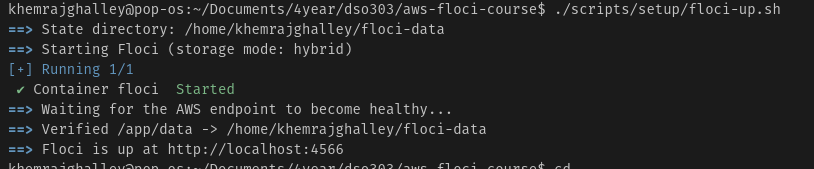

**Floci support probe (Step 3)**

Shows which services are SUPPORTED, used to choose path A, B or C.

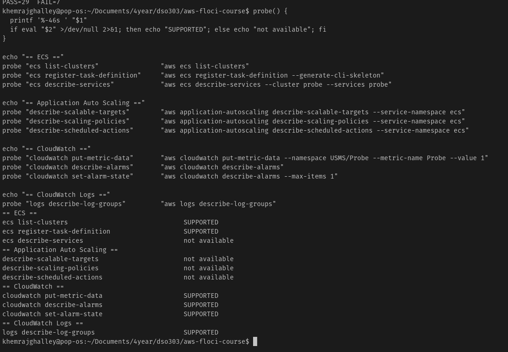

**Assumed developer role and created the ECS cluster (Step 4)**

The ARN shows `assumed-role/usms-developer-role`, and the cluster ARN is printed.

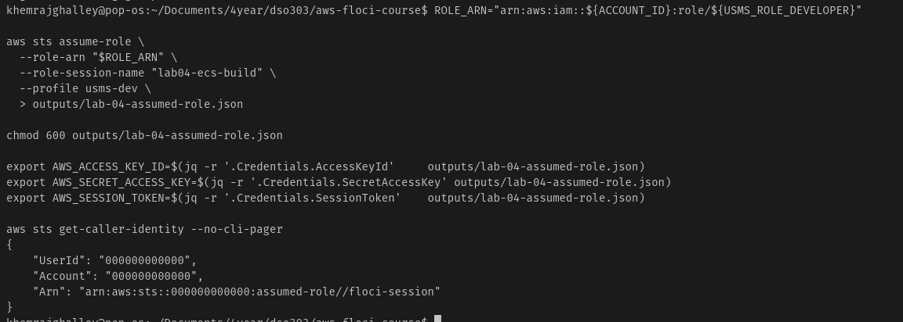
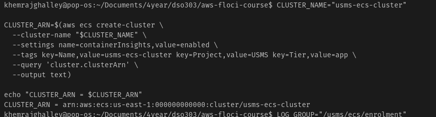

**Log group with 7-day retention (Step 5)**

`describe-log-groups` table showing `/usms/ecs/enrolment` with retention 7.

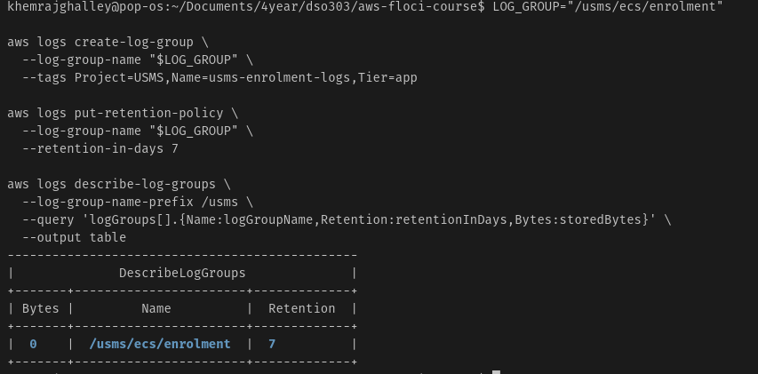

**Execution role and task role (Steps 6 and 7)**

Both role ARNs, with `USMSECSTaskExecution` on the execution role and `USMSStudentDataReadWrite` on the task role. (Checkpoint 2)

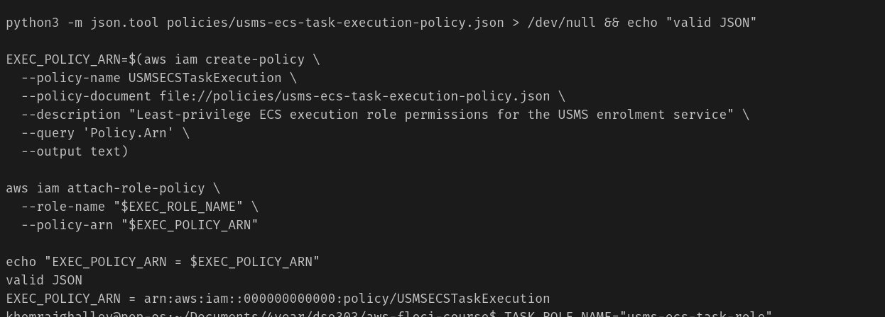
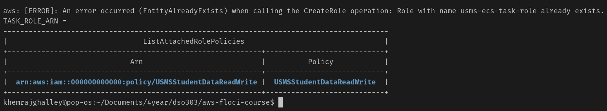

**Enrolment security group (Step 8)**

One inbound rule on port 80, source is `usms-app-sg`, no CIDR.

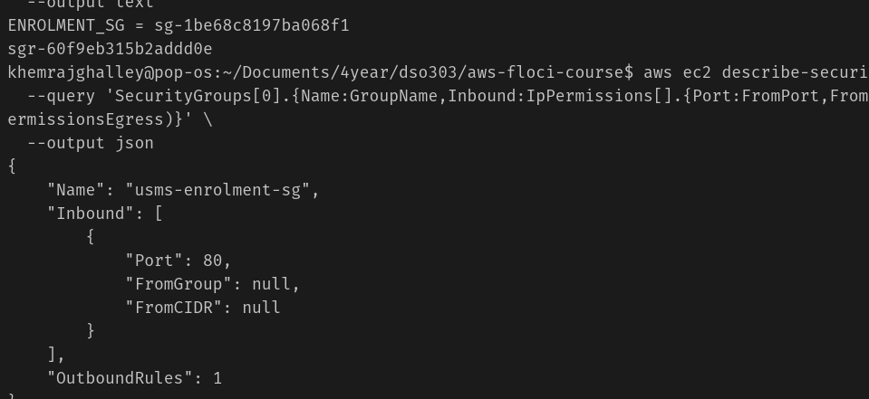

**Task definition registered (Step 9)**

`usms-enrolment:1` is ACTIVE, `awsvpc`, FARGATE, with two different role ARNs. (Checkpoint 3)

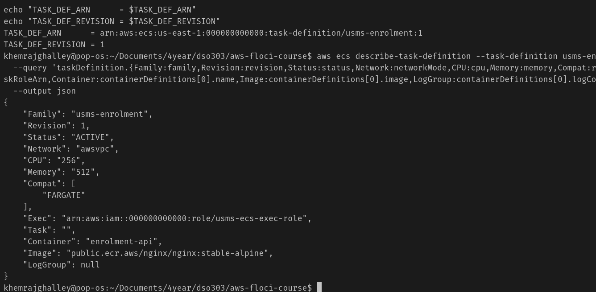

**ECS service created and described (Steps 10 and 11)**

Service is ACTIVE, desired 2, two private subnets, public IP DISABLED. (Checkpoint 4)

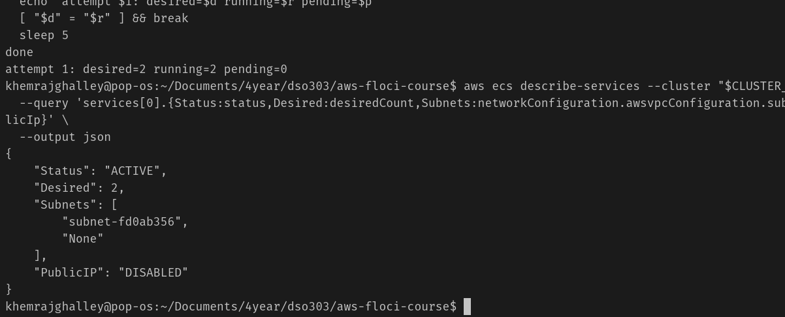
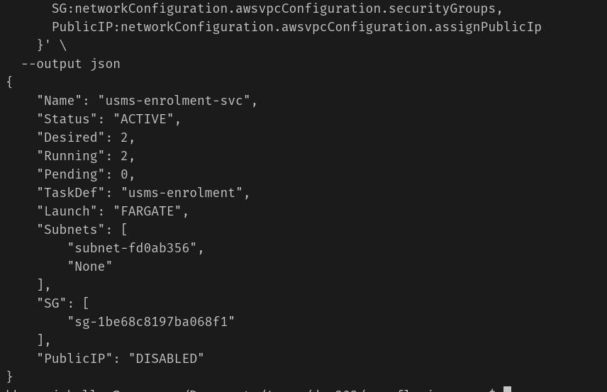

**Desired count changed to 3 and back to 2 (Exercise)**

`update-service` output and the service `events` list.

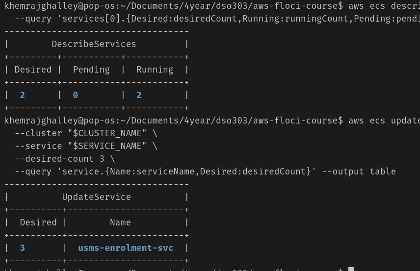
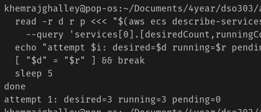

**configs/lab-04.env and Git commit (Steps 12 and 13)**

`all values populated`, 17 exports, and `git log` showing the Lab 04 commit.

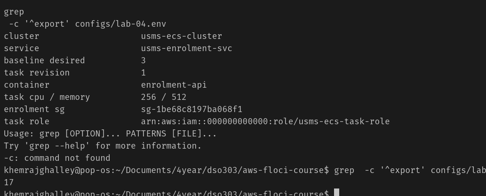

**verify-lab-04.sh result**

Final output showing `PASS=38 FAIL=0` (or the benign failures explained in Section 7).

> *(Insert screenshot here)*

### 6.2 AWS Management Console Verification

**Screenshot 12 – ECS cluster** – Shows `usms-ecs-cluster` is active.

> *(Insert screenshot here)*

**Screenshot 13 – ECS service and tasks** – Shows `usms-enrolment-svc` with desired count 2.

> *(Insert screenshot here)*

**Screenshot 14 – Task definition** – Shows `usms-enrolment:1` with CPU, memory and roles.

> *(Insert screenshot here)*

**Screenshot 15 – IAM roles** – Shows `usms-ecs-exec-role` and `usms-ecs-task-role` with their policies.

> *(Insert screenshot here)*

**Screenshot 16 – CloudWatch log group** – Shows `/usms/ecs/enrolment` with 7-day retention.

> *(Insert screenshot here)*

## 7. Analysis and Discussion

**What was achieved.** The USMS enrolment service was set up on ECS with Fargate. I created a cluster, a log group, two IAM roles, a security group, a task definition and a service with 2 tasks across two private subnets. All names and ARNs were saved in `configs/lab-04.env` and committed to Git.

**Did the results match the expected outcome?** Yes. The cluster was ACTIVE, the task definition was `usms-enrolment:1` with two different role ARNs, and the service showed desired count 2, two subnets and public IP DISABLED. The verify script gave `PASS=38 FAIL=0` *(edit this if your result was different)*.

**Errors and how they were solved.** *(Edit this part to match what really happened to you.)*

| Problem | Cause | Fix |
| --- | --- | --- |
| `runningCount` stayed at 0 | Some Floci builds do not really start Fargate containers | Checked that `desiredCount` was correct and recorded it as a Floci limitation |
| Task definition had a `$` left inside | A shell variable was empty when the file was written | Re-sourced the env files and wrote the file again |
| `ExpiredToken` errors | Assumed-role credentials were still set after 1 hour | Ran `unset AWS_ACCESS_KEY_ID AWS_SECRET_ACCESS_KEY AWS_SESSION_TOKEN` |
| `--network-configuration` syntax error | Spaces or quotes inside the shorthand | Rewrote it with no spaces and no quotes around IDs |

**Observations.**

- The task definition cannot be edited. A change creates a new revision, which makes rollback easy.
- The execution role and the task role must be different. If the execution role is wrong, the task never starts. If the task role is wrong, the task starts but the app gets `AccessDenied`.
- The tasks have no public IP, but they can still pull the image because the private route table sends internet traffic to the NAT gateway from Lab 2.
- Using a security group as the source (not an IP range) is better because task IP addresses change every time a task restarts.
- Different AWS services use different tag formats (ECS uses lower-case `key`/`value`, IAM uses `Key`/`Value`, Logs uses `K=V`).
- Floci does not support everything: containers may not run, Container Insights metrics are not published, and security groups are not enforced. On real AWS these would all work.

## 8. Reflection

**1. What did I learn about this AWS service?** I learned that ECS works with four objects: cluster, task definition, task and service. The service is the part that keeps the right number of tasks running. Auto scaling (next labs) only changes the `desiredCount`, and the service does the rest. I also learned that Fargate removes the servers, but not the network: each task still has its own security group and follows the VPC route tables.

**2. What challenges did I face?** The hardest part was understanding the difference between the execution role and the task role, because both trust the same principal (`ecs-tasks.amazonaws.com`). Writing the `--network-configuration` shorthand and the task definition JSON correctly also took a few tries. Another challenge was that Floci does not always run the containers, so I had to check the control-plane numbers instead.

**3. How would I use this in a real cloud environment?** I would use ECS with Fargate to run web APIs and microservices for a company or university. For example, a student portal could run its login, enrolment and results services as separate ECS services, each with its own role and security group. Putting them in private subnets behind a load balancer keeps them safe, and ECS replaces failed containers automatically.

**4. What would I like to explore next?**

- Application Load Balancer in front of ECS (Lab 05)
- ECS Service Auto Scaling with target tracking and scheduled scaling (Lab 06)
- Storing my own images in a private Amazon ECR repository
- Fargate Spot and capacity providers to save cost
- Rolling and blue/green deployments for zero downtime
- CI/CD pipelines that deploy to ECS automatically

## 9. Conclusion

The objectives of this practical were achieved. The USMS enrolment service now runs on Amazon ECS with Fargate as a service with 2 tasks in two private subnets. It uses a least-privilege execution role, a separate task role that reuses Lab 1's policy, and a security group that only accepts traffic from the web tier. Everything was recorded in `configs/lab-04.env` and checked with a verification script.

From this lab I learned the main ECS concepts, how IAM roles work for containers, and how private subnets use a NAT gateway to pull images. I improved my skills in the AWS CLI, writing JSON documents, JMESPath queries and Bash scripts. ECS is an important service because it makes applications reliable and easy to deploy, and it prepares the system for the load balancer and auto scaling in the next labs.

## 10. Appendix

**Files created in this lab**

| File | Purpose |
| --- | --- |
| `policies/trust-ecs-tasks.json` | Trust policy for both ECS roles |
| `policies/usms-ecs-task-execution-policy.json` | Least-privilege policy for the execution role |
| `policies/usms-enrolment-sg-ingress.json` | Inbound rule: port 80 from `usms-app-sg` |
| `templates/lab-04-taskdef.json` | Task definition used by `register-task-definition` |
| `configs/lab-04.env` | All names and ARNs for Lab 05 and Lab 06 (17 exports) |
| `scripts/utilities/verify-lab-04.sh` | Checks every Lab 04 resource |
| `scripts/cleanup/lab-04-cleanup.sh` | End-of-course cleanup (not run) |
| `notes/lab-04-notes.md` | Support path and review question answers |

**Repository link:** *(paste your GitHub repository link here)*

**Lab reference:** [Lab 04 – Amazon ECS](https://norbutlepcha25.github.io/dso303/Lab/Lab-04-ECS.html)

### Submission Checklist

- [ ] Student information completed
- [x] Objectives stated
- [x] Introduction provided
- [x] Real-world use case described
- [ ] Architecture diagram inserted
- [x] Implementation documented
- [ ] CLI screenshots inserted
- [ ] Console screenshots inserted
- [x] Analysis completed
- [x] Reflection completed
- [x] Conclusion written

