# Lab 05 Report – Application Load Balancer for the ECS Service

## 1. Aim / Objective

In this practical I put the enrolment service from Lab 04 behind an Application Load Balancer (ALB). The tasks from Lab 04 only had private IP addresses that change every time a task restarts, so there was no fixed address to call them. The ALB gives the service one stable name.

For this practical put the ALB in front of the ECS service, and then removed the old direct rule from the web server. only the ALB can reach the tasks, and ECS adds and removes its own targets automatically. I also added a listener rule for `/alb-health` that returns a fixed 200 response without touching any task.

My objectives were:

- Create an internet-facing ALB in the two public subnets from Lab 2, with its own security group.
- Create a target group with type `ip`, a health check, and a 30 second deregistration delay.
- Create a listener on port 80 that forwards traffic to the target group, and add one listener rule for `/alb-health`.
- Connect the existing ECS service to the target group, so ECS adds and removes its own tasks as targets.
- Do the "cutover": remove the old direct rule from the web server, so only the ALB can reach the tasks.
- Check that everything survives a Floci restart, and save all ARNs in `configs/lab-05.env` for Lab 06.

## 2. Introduction

Elastic Load Balancing is an AWS service that takes incoming traffic and shares it between many servers. The Application Load Balancer is the type that understands HTTP, so it can look at things like the URL path and decide where to send each request. Instead of users needing to know the IP address of each task, they just call the load balancer's DNS name, and the ALB sends the request to a healthy target. If a target stops working, the ALB notices through its health check and stops sending it traffic. This is very important in cloud computing because it gives high availability, lets you add or remove servers without users noticing, and allows updates with no downtime. ALBs are used in front of websites, APIs, microservices and container apps.

The ALB is made of four parts that link together:

| Part | What it does in simple words |
| --- | --- |
| Load balancer | The front door. It has a DNS name, sits in subnets and has a security group. |
| Listener | Listens on one port (here HTTP 80) and has one default action. |
| Rule | A condition and an action, for example "if the path is `/alb-health`, reply 200". Lowest priority number is checked first. |
| Target group | The list of targets plus the health check. ECS adds the tasks here. |

**Key features**

- Layer 7 (HTTP) routing based on path, host or headers
- Health checks that remove broken targets automatically
- Works across two or more Availability Zones
- Connection draining (deregistration delay) so in-flight requests finish
- Direct integration with ECS, so tasks register themselves
- Has its own security group
- Fixed responses, redirects and weighted forwarding

## 3. Use Case

In our USMS project, the enrolment service runs as 2 ECS tasks in private subnets. Before this lab, the web server had to call a task directly by its private IP. That is a problem because the IP changes whenever a task is replaced, and during enrolment week the number of tasks will change (Lab 06 adds auto scaling).

With the ALB, the web server calls one fixed DNS name. The ALB sends each request to a healthy task and skips any task that is broken or being replaced. When ECS starts a new task, it registers it in the target group by itself, and when a task stops, ECS removes it and the ALB lets its open requests finish first. The tasks stay private, and only the ALB is allowed to talk to them.

## 4. System Architecture / Design

&#91;embedded content: Lab 05 architecture · ALB in front of the ECS enrolment service\]

A client calls the ALB's DNS name on port 80. The listener checks its rule first (`/alb-health` gets a fixed 200), and everything else is forwarded to the target group, which only sends traffic to healthy tasks. The tasks stay in the private subnets, and after the cutover their security group only accepts traffic from `usms-alb-sg`; the old direct rule from `usms-app-sg` was removed. The ECS service adds and removes task IPs in the target group by itself.

> *(Optional: replace or add your own architecture screenshot here)*

## 5. Implementation Procedure

I ran all commands with the AWS CLI against Floci from the `aws-floci-course/` folder.

1. **Started the environment.** Started Floci and loaded the five env files (`course.env` and `lab-01` to `lab-04`). I checked that 12 values were not empty, especially both public subnets, because an ALB needs two Availability Zones.
2. **Checked the old labs.** Ran `verify-lab-02.sh`, `verify-lab-03.sh` and `verify-lab-04.sh`. I saved the Lab 04 result to `outputs/lab-05-pre-verify-04.txt` to compare later.
3. **Checked Floci support.** Ran a `probe` function to see which ELBv2 and ECS calls work, and wrote my support path (A, B or C) in `notes/lab-05-notes.md`.
4. **Created the ALB security group.** Created `usms-alb-sg` and allowed TCP 80 from `0.0.0.0/0` using a JSON file. This is the only rule open to the whole internet in the course, and it is on purpose. For "Your turn" I also added port 443.
5. **Created the load balancer.** Ran `aws elbv2 create-load-balancer` for `usms-enrolment-alb` (application, internet-facing) in both public subnets with `usms-alb-sg`. I saved the ARN and DNS name and set `idle_timeout` to 60 and `drop_invalid_header_fields` to true.
6. **Created the target group.** Created `usms-enrolment-tg` with `--target-type ip`, HTTP 80, and a health check on `/` every 30 seconds (timeout 5, healthy 2, unhealthy 2, matcher 200). For "Your turn" I changed the matcher to `200-399` and back to `200`.
7. **Set the target group attributes.** Set `deregistration_delay` to 30 seconds and the algorithm to `least_outstanding_requests`.
8. **Created the listener.** Wrote the default action (forward to the target group) in a JSON file and created an HTTP listener on port 80.
9. **Let the ALB reach the tasks.** Added a rule to `usms-enrolment-sg` allowing TCP 80 from `usms-alb-sg`. At this point both the old web path and the new ALB path were allowed.
10. **Connected the ECS service.** Used `aws ecs update-service` with `--load-balancers` (container `enrolment-api`, port 80) and `--health-check-grace-period-seconds 60`. The task definition did not change.
11. **Watched the targets.** Used `describe-target-health` to see the task IPs appear in the target group, and compared ECS health with target health. For "Your turn" I set the desired count to 3 and back to 2 and saw targets added and removed without running `register-targets`.
12. **Proved the path.** Tried `curl` on the ALB DNS name. I also ran the control-plane proof that follows the chain from listener to target group to tasks to security group, and saved it to `outputs/lab-05-path-proof.txt`.
13. **Did the cutover.** Found the old rule from `usms-app-sg` with `describe-security-group-rules` and removed it with `revoke-security-group-ingress`. Then `verify-lab-04.sh` showed exactly one expected failure.
14. **Forced a new deployment.** Ran `update-service --force-new-deployment` and watched targets go from `initial` to `healthy` to `draining`.
15. **Added a listener rule.** Created a rule with priority 10: path `/alb-health` returns a fixed 200 response without touching any task.
16. **Tested a restart.** Saved the configuration, stopped and started Floci, found every ARN again from the API, and used `diff` to confirm nothing changed.
17. **Audited the setup.** Confirmed that only `usms-alb-sg` can reach the tasks (`CUTOVER CONFIRMED`) and that `usms-web-01` still carries `usms-app-sg` (`LOOP CLOSED`).
18. **Saved outputs.** Wrote `configs/lab-05.env` using lookups (15 exports, no empty values).
19. **Committed and pushed.** Checked `git status`, made sure nothing in `outputs/` was staged, added files by name, committed and pushed. I also built `verify-lab-05.sh` and `lab-05-cleanup.sh` (the cleanup script was only syntax checked, not run).

## Results and Evidence

### CLI Output

**Environment loaded and old labs verified**

All 12 values printed, and the three verify scripts show `FAIL=0`.

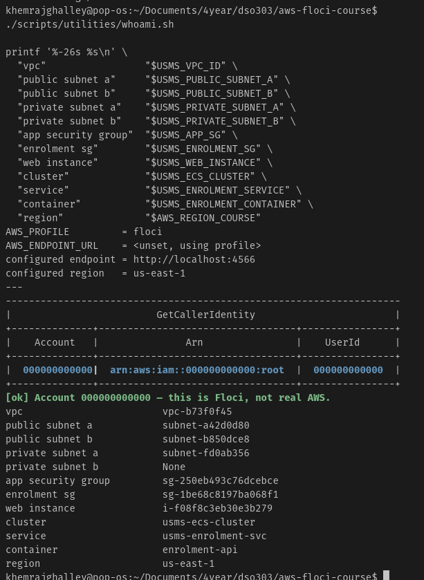
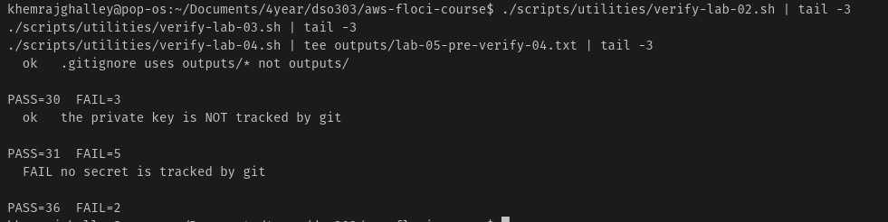

**Floci ELBv2 probe**

Shows which ELBv2 and ECS calls are SUPPORTED, used to choose my path.

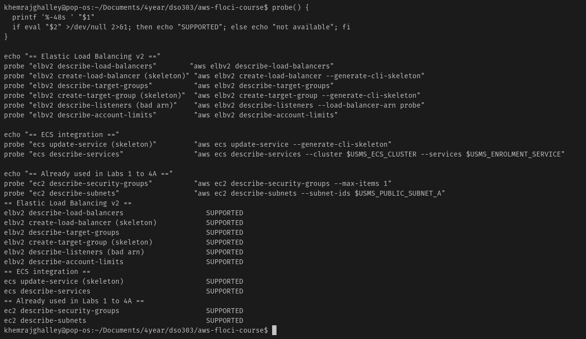

**ALB security group**

`usms-alb-sg` with port 80 open from `0.0.0.0/0`.

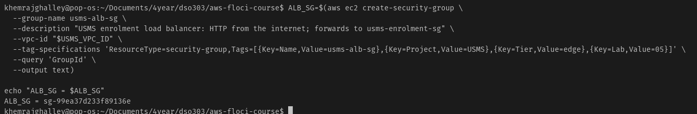
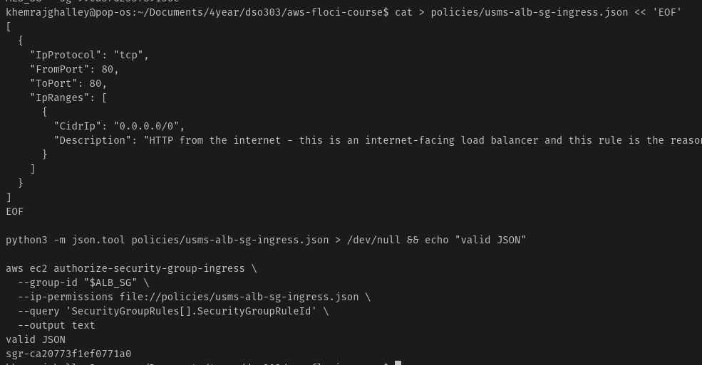

**Load balancer created and active**

ALB ARN, DNS name, two AZs, internet-facing, application type.
Write the rule as a JSON file
```bash
cat > policies/usms-alb-sg-ingress-443.json << 'EOF'
[
  {
    "IpProtocol": "tcp",
    "FromPort": 443,
    "ToPort": 443,
    "IpRanges": [
      {
        "CidrIp": "0.0.0.0/0",
        "Description": "HTTPS from the internet - opened ahead of an HTTPS listener"
      }
    ]
  }
]
EOF

python3 -m json.tool policies/usms-alb-sg-ingress-443.json > /dev/null && echo "valid JSON"
```
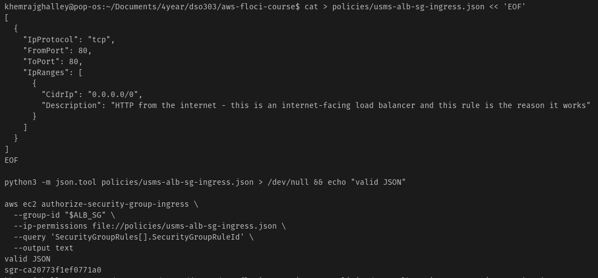

Add it to the security group
```bash
aws ec2 authorize-security-group-ingress \
  --group-id "$ALB_SG" \
  --ip-permissions file://policies/usms-alb-sg-ingress-443.json \
  --query 'SecurityGroupRules[].SecurityGroupRuleId' \
  --output text
  ```
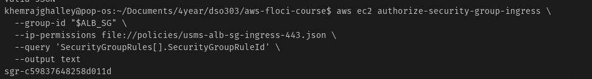

checking it
```bash
aws ec2 describe-security-groups --group-ids "$ALB_SG" \
  --query 'SecurityGroups[0].IpPermissions[].{Port:FromPort,CIDR:IpRanges[0].CidrIp}' \
  --output table
```

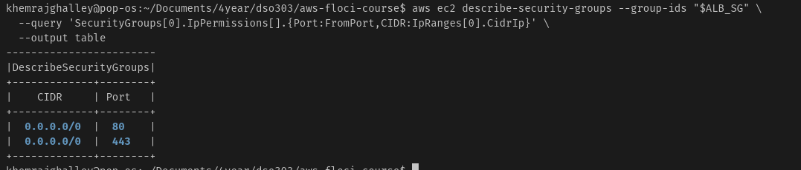

**Target group and attributes**

Type `ip`, health check on `/`, matcher 200, deregistration delay 30.

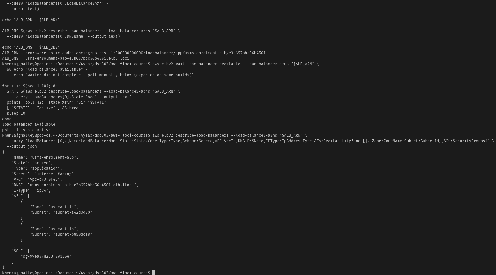
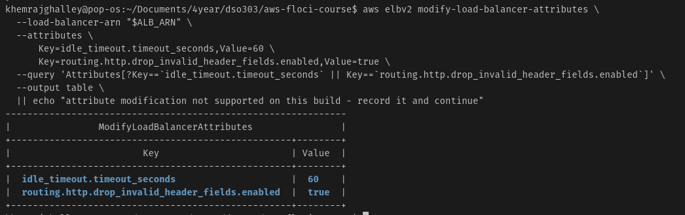

**Listener created**

HTTP 80 forwarding to `usms-enrolment-tg`, target group now attached to 1 load balancer. (Checkpoint 3)

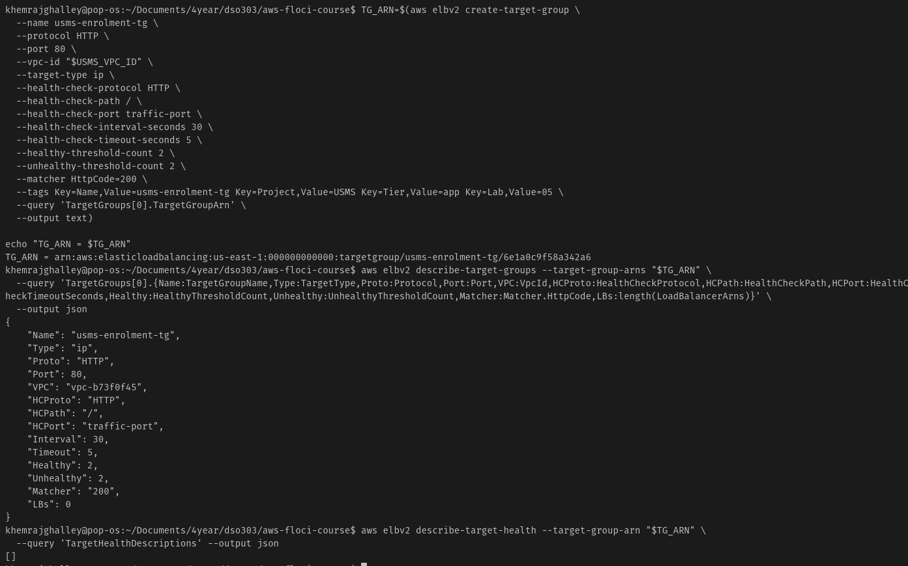

```bash
aws elbv2 modify-target-group \
  --target-group-arn "$TG_ARN" \
  --matcher HttpCode=200-399 \
  --query 'TargetGroups[0].Matcher.HttpCode' --output text

aws elbv2 modify-target-group \
  --target-group-arn "$TG_ARN" \
  --matcher HttpCode=200 \
  --query 'TargetGroups[0].Matcher.HttpCode' --output text

aws elbv2 describe-target-groups --target-group-arns "$TG_ARN" \
  --query 'TargetGroups[0].Matcher.HttpCode' --output text
```

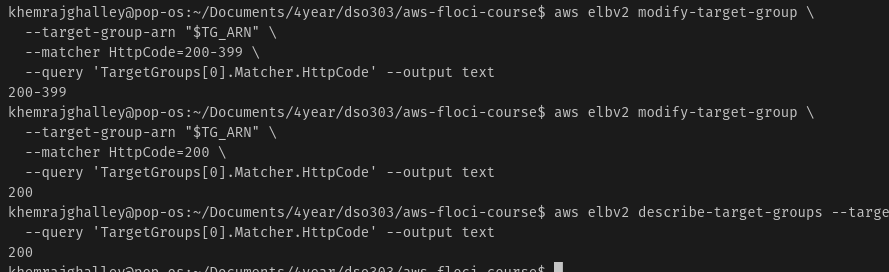

(a) A web app whose home page / sends a redirect, for example a student portal that sends anyone not logged in from / to /login with a 302. The service works fine, but with a strict 200 matcher the health check gets a 302 every time, so the targets are marked unhealthy forever.

(b) It would be a problem in my work, not in the script. A verification script exists to check that the system matches the design we agreed on, and the design says the matcher is 200. If I left it at 200-399 without a reason, the script would be correctly catching drift. If 200-399 were a deliberate design change, I would update the script in the same commit, so the script and the system always describe the same thing.

**Enrolment security group with two sources**

Port 80 allowed from both `usms-app-sg` and `usms-alb-sg`.

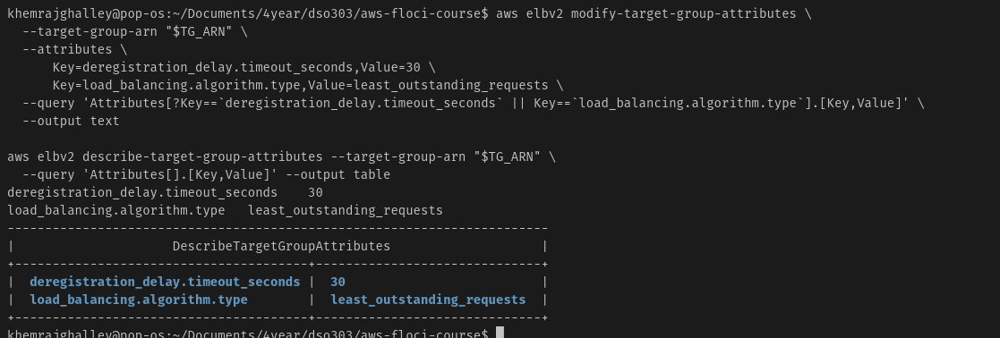

**Service attached to the target group**

`loadBalancers` entry with `enrolment-api` on port 80 and grace period 60.


**Target health**

Task IPs in the target group and their state, plus the 3 → 2 desired count test. (Checkpoint 4)

<!--  -->

**Path proof**

The `curl` result and the five-block control-plane proof.

**Cutover**

Old rule removed (`True`), only `usms-alb-sg` left, and the `diff` showing one expected failure in `verify-lab-04.sh`.


**Forced deployment**

Polling output showing `initial`, `healthy` and `draining`. (Checkpoint 5)

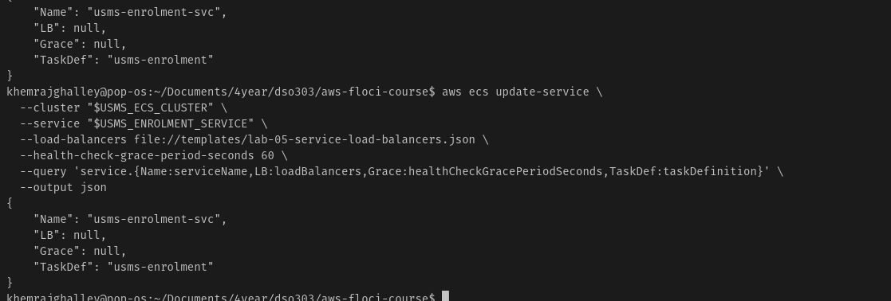

**Listener rule**

`describe-rules` showing priority 10 fixed-response and the default forward action. (Checkpoint 6)

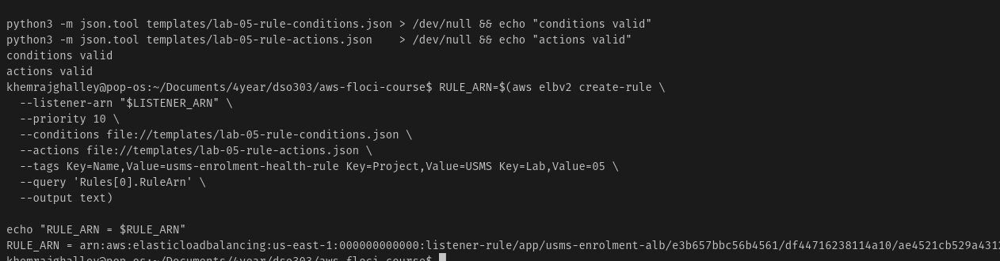
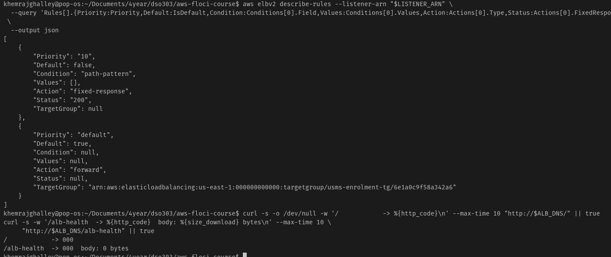

**Restart test**

`PERSISTENCE PROVEN` message after the Floci restart. (Checkpoint 7)

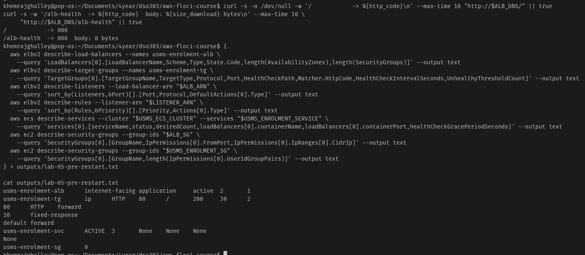
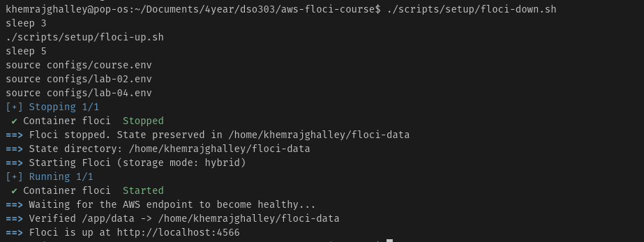
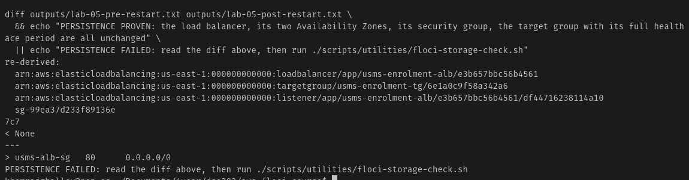

**Screenshot 15 – Audit (Step 17)**

`CUTOVER CONFIRMED` and `LOOP CLOSED`.

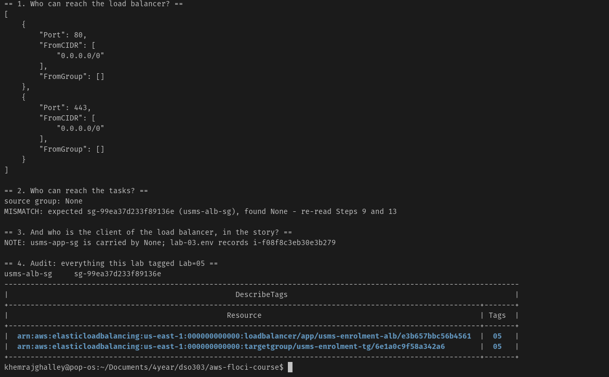

**lab-05.env, verify script and Git**

`all values populated`, 15 exports, `verify-lab-05.sh` result, and `git log`.

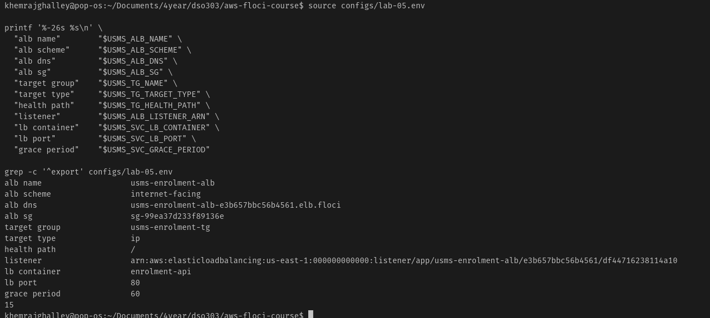

<!-- ### 6.2 AWS Management Console Verification

**Screenshot 17 – Load balancer** – Shows `usms-enrolment-alb` is active in two AZs.

> *(Insert screenshot here)*

**Screenshot 18 – Target group** – Shows `usms-enrolment-tg` with its registered targets and health.

> *(Insert screenshot here)*

**Screenshot 19 – Listener and rules** – Shows the HTTP 80 listener with the `/alb-health` rule and the default action.

> *(Insert screenshot here)*

**Screenshot 20 – Security groups** – Shows `usms-alb-sg` and `usms-enrolment-sg` inbound rules after the cutover.

> *(Insert screenshot here)*

**Screenshot 21 – ECS service** – Shows `usms-enrolment-svc` linked to the target group.

> *(Insert screenshot here)* -->

## 7. Analysis and Discussion

**What was achieved.** The enrolment service is now behind an internet-facing ALB in two public subnets. The listener forwards traffic to a target group, and the ECS service fills that target group with its own tasks. After the cutover, the only thing that can open a connection to the tasks is the ALB's security group. The setup also survived a Floci restart, and all ARNs are saved in `configs/lab-05.env` for Lab 06.
<!-- 
**Did the results match what was expected?** Mostly yes. All the objects (ALB, target group, listener, rule, service link, security group rules) were created and could be read back with the right values. The part that did not fully match was the data path: *(edit to match your result – e.g. "`curl` could not reach the DNS name, and target health stayed `initial`, so I used the control-plane proof from Step 12 instead")*. The lab says this is normal on Floci and that every check is based on control-plane fields. -->
<!-- 
**Errors I hit and how I fixed them.** *(Keep the rows that happened to you and delete the rest.)*

| Problem | Why it happened | How I fixed it |
| --- | --- | --- |
| `verify-lab-04.sh` showed `FAIL=1` after Step 13 | The check still expects `usms-app-sg` as the source, but I removed that rule on purpose | Left it and documented it as an expected failure. `verify-lab-05.sh` is now the main check |
| `aws ... wait` failed with a `length()` error | Floci returns some fields as `null` instead of a list | Used the manual polling loops instead of the waiter |
| `curl` could not connect to the ALB | Floci has no public DNS and only exposes port 4566 | Used the five-block control-plane proof and saved it to `outputs/lab-05-path-proof.txt` |
| Target group stayed empty or `initial` | Floci does not really run the containers or health checks | Confirmed the `loadBalancers` entry on the service and recorded it as a limitation |
| Variables were empty in a new terminal | Shell variables are lost when the terminal closes | Sourced the env files again and re-derived ARNs with `describe-*` calls | -->

**What I noticed while doing it.**

- The target group must be type `ip` because Fargate tasks have no instance ID. This cannot be changed later.
- I should never run `register-targets` by hand. The ECS service owns the target list and would undo my changes.
- The order of Steps 9, 12 and 13 matters: first add the new path, then prove it, then remove the old one. This is a migration, not an outage.
- A failing check is not always a mistake. Lab 04's script failed because the design changed, not because something broke.
- ECS health and target health can disagree. ECS `HEALTHY` with target `unhealthy` usually means the network path (security group) is wrong, not the app.
- The deregistration delay (30 s) and grace period (60 s) are small numbers, but they decide whether users see errors during a deployment.

## 8. Reflection

Before this lab I thought a load balancer was just one thing. Now I know it is a chain: load balancer, listener, rules and target group, and the health check lives on the target group, not on the load balancer. I also learned that with ECS, the service registers and removes targets by itself, which is what makes auto scaling possible in Lab 06. The idea that I really understood is that security groups can point to other security groups, so "only the ALB can reach the tasks" is one rule, even when IPs keep changing.

<!-- The hardest part was that a lot of things look like they worked even when they did not fully work on Floci, like target health and `curl`. At first I thought I made a mistake, but then I learned to check the control plane instead and be honest about which proof I actually got. Writing the JMESPath queries with backticks and the escaping in Step 13 was also confusing. The expected failure in `verify-lab-04.sh` worried me until I read why it happens. -->

**3. How would I use this in a real cloud environment?** I would put an ALB in front of any web app or API that runs on more than one server or container. For example, for a college portal I could use path rules to send `/enrolment` and `/results` to different services, add HTTPS with a certificate from ACM, and redirect HTTP to HTTPS. I would also keep the app servers in private subnets and only allow the ALB's security group, like in this lab.

**4. What would I like to explore next?**

- HTTPS listeners with ACM certificates
- Auto scaling using `ALBRequestCountPerTarget` (Lab 06)
- Blue/green and canary deployments with weighted target groups
- Internal load balancers for service-to-service traffic
- AWS WAF in front of the ALB for security
- ALB access logs and CloudWatch metrics

## 9. Conclusion

The objectives of this practical were achieved. The USMS enrolment service now has a stable entry point through `usms-enrolment-alb`, with a target group that ECS keeps up to date, a listener with a default action and one rule, and a security setup where only the ALB can reach the private tasks. The configuration survived a restart and is saved in `configs/lab-05.env` for the next lab.

Through this lab I learned how an ALB, listener, rules and target groups work together, how health checks and draining make deployments safe, and how to change a running system without breaking it. I got more practice with the AWS CLI, JSON files, JMESPath queries and checking my own work with scripts. The ALB is an important AWS service because it gives applications high availability and a single address, and it is the base for auto scaling in Lab 06.
<!-- 
## 10. Appendix

**Files created in this lab**

| File | Purpose |
| --- | --- |
| `policies/usms-alb-sg-ingress.json` | ALB inbound rule: TCP 80 from the internet |
| `policies/usms-enrolment-sg-ingress-alb.json` | Task inbound rule: TCP 80 from `usms-alb-sg` |
| `templates/lab-05-listener-default-actions.json` | Listener default action: forward to the target group |
| `templates/lab-05-rule-conditions.json` | Rule condition: path `/alb-health` |
| `templates/lab-05-rule-actions.json` | Rule action: fixed 200 response |
| `templates/lab-05-service-load-balancers.json` | Links the ECS service to the target group |
| `configs/lab-05.env` | All names and ARNs for Lab 06 (15 exports) |
| `scripts/utilities/verify-lab-05.sh` | Checks every Lab 05 resource |
| `scripts/cleanup/lab-05-cleanup.sh` | End-of-course cleanup (not run) |
| `notes/lab-05-notes.md` | Support path, "Your turn" answers and review questions |
 -->


