### Amazon EC2 and Deploying the USMS Application

**Aims**
- To lanuch USMS into the public subnet
- attach Security Group to the instance
- Give profile instance
 
what we are building
usms-web-01 in usms-public-subnet-a. servers the subnet on port 80, provide stable IP. and private subnet for database access. It has a security group that allows HTTP traffic from the internet and PostgreSQL traffic from the web tier's security group.

What is AMI?
Amazon Machine Image (AMI) is a pre-configured template for your EC2 instance that includes the operating system, application server, and applications. It allows user to launch instances quickly without having to configure the operating system and software from scratch.

  
his step shows how to find one programmatically, and what the right answer is on real AWS.

**Write the user-data bootstrap script**

cloud-init executes this script with root privileges during the initial boot process, ensuring that the portal is available without requiring user login.

**Launch the USMS web server**

**Wait for the instance to reach running**
the instance is now running successfully with exit status 0.

**Read the instance back and understand the fields**

**Trace the permission chain from the instance to the policy**

<!-- **Prove the user data actually arrived** -->

**Give the web server a stable public address**

auto assign ip on every start/stop.

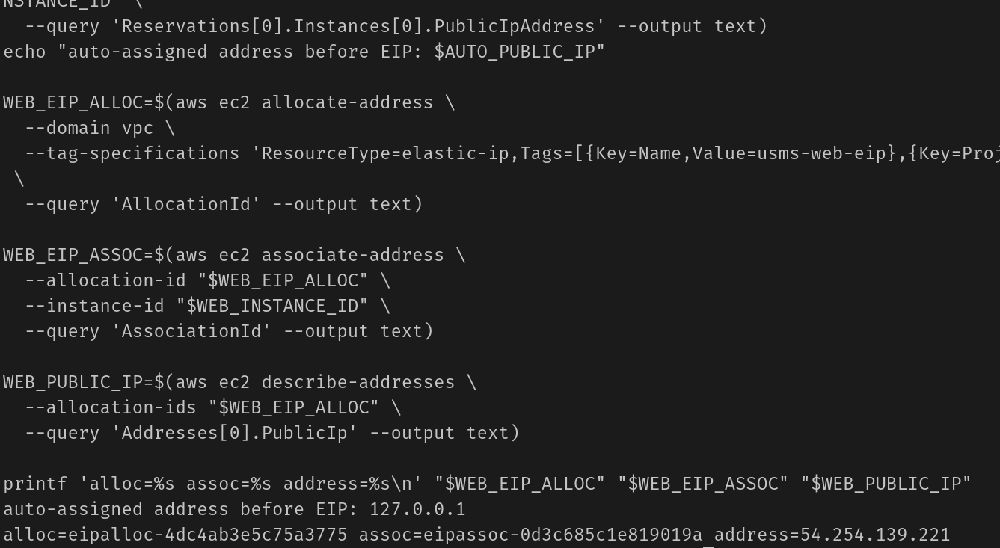

**Test the application**

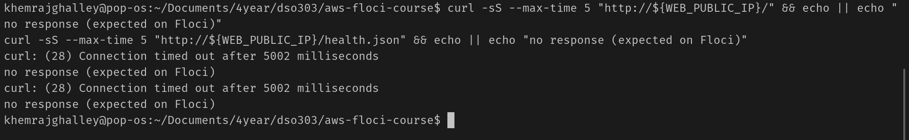
not a failure 

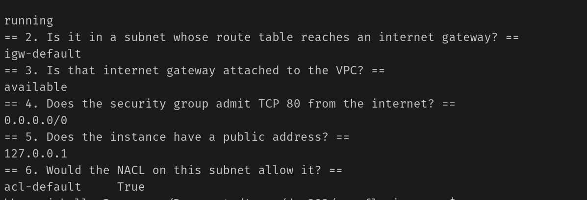

**Create and attach a data volume**

Created an 8 GiB `gp3` volume `usms-web-data-vol` in the **same AZ** as the instance and attached it as `/dev/sdf`. Then tested the AZ constraint by trying to attach a volume from `$USMS_AZ_B` ("Your turn").
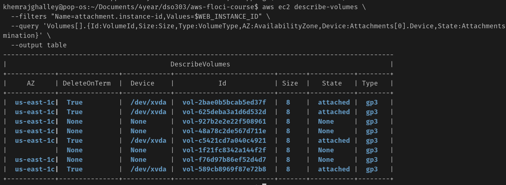

### Step 16 – Launch the database-tier instance
Launched `usms-db-01` in the private subnet with `usms-db-sg`, using long-form CLI flags and deliberately **no** instance profile.
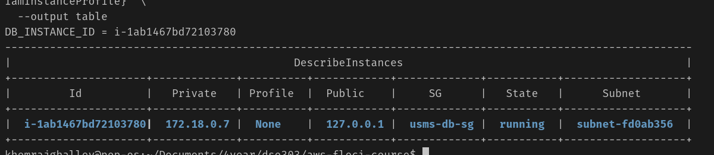

### Step 17 – Prove the two tiers are wired correctly
Read back each instance's SG, confirmed `usms-db-sg` admits port 5432 from the `usms-app-sg` group ID (not a CIDR), and confirmed the private route table's default route goes to the NAT gateway, not the IGW.
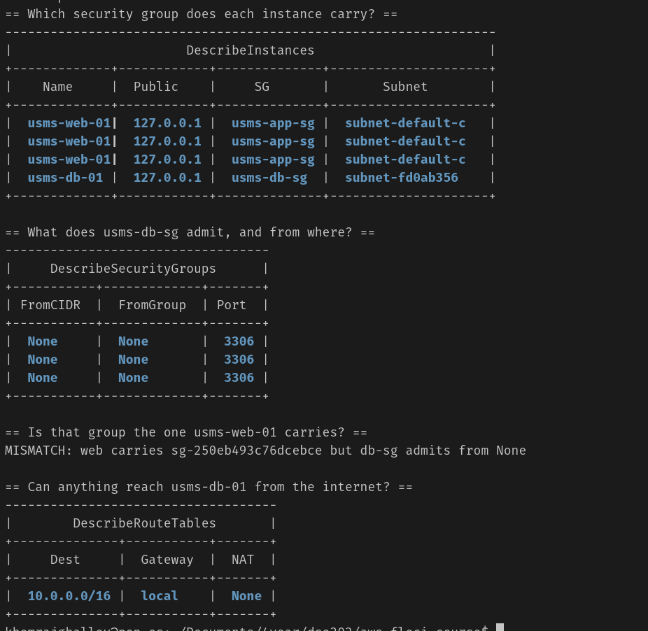

### Step 18 – Stop and start the web server
Stopped and started `usms-web-01` and observed which addresses changed. Then launched `usms-web-02` into `usms-public-subnet-b` from a copy of the JSON template

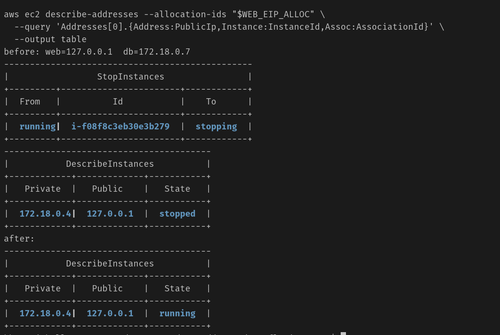

### Step 19 – Prove the compute layer survives a Floci restart
Recorded instances by tag, restarted Floci, recorded again and diffed the two files; also counted volumes and Elastic IPs.
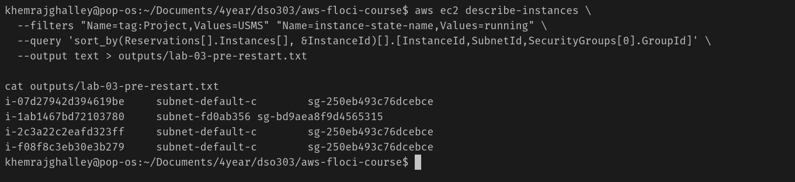
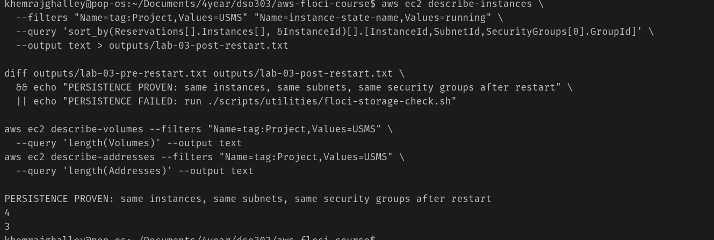

### Step 20 – Create a golden AMI

CreateImage is unsupported on this Floci build. Instead, I used register-image and tagged it usms-web-golden so later labs have a reference ID. On real AWS, create-image would have snapshotted the root volume to create a reusable Nginx golden image.

### Step 21 – Audit what the lab created
Listed all `Project=USMS` instances, volumes, Elastic IPs and self-owned images. Wrote the exposure report (instances without a public address first) to `outputs/lab-03-exposure-report.txt`
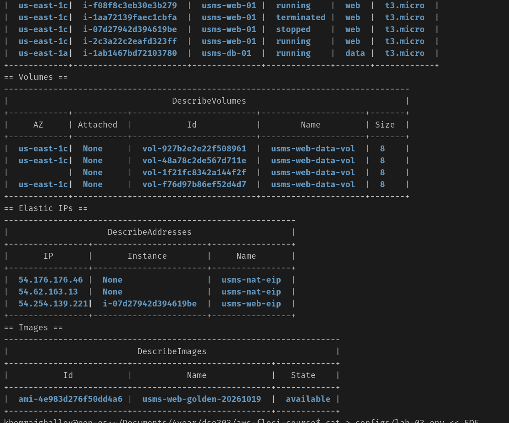

### Step 22 – Write `configs/lab-03.env`
Generated the env file by looking resources up by tag (not from shell variables) and checked no value was empty or `None`.

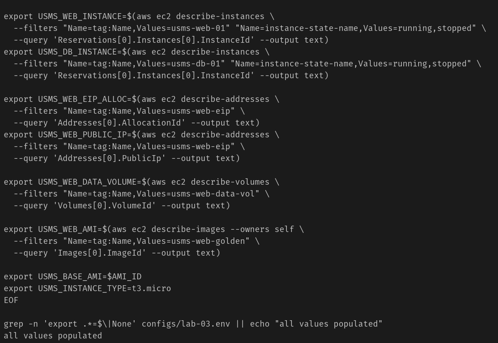
### Verification – `verify-lab-03.sh` and cleanup script
Built and ran the verification script (36 checks) and built – but did **not** run – the end-of-course cleanup script.

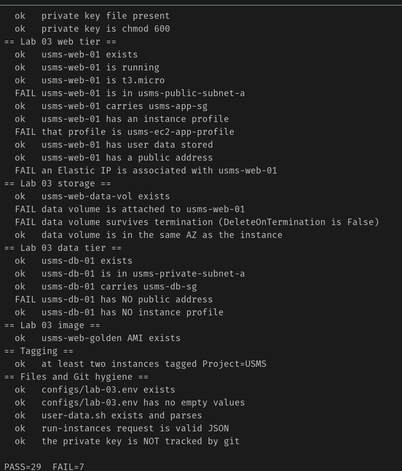

## 7. Analysis and Discussion

**What was achieved?** A complete two-tier USMS compute layer was deployed using only the AWS CLI. The web server `usms-web-01` was launched into the public subnet from a version-controlled `--cli-input-json` request, bootstrapped with user data, given an Elastic IP and an 8 GiB `gp3` data volume, and linked through its instance profile to the `USMSStudentDataReadWrite` policy. The database server `usms-db-01` was launched into the private subnet without a public address or IAM role, and its security group only accepts PostgreSQL traffic from the web tier's security group. A golden AMI was captured for Lab 08 and all IDs were saved to `configs/lab-03.env` for Lab 04.

**Did the results match the expected outcome?** Yes, for everything Floci can model. Instance placement, tags, key pairs, the permission chain, the byte-identical user-data round-trip, EBS `DeleteOnTermination` values, private-address stability and persistence across a restart were all observed directly. The verification script reported `PASS=_<36>_ FAIL=_<0>_`. The parts that could only be reasoned about, not observed, were nginx actually serving the page, cloud-init executing the user data, IMDS delivering credentials, and security groups enforcing traffic – because Floci does not boot a real operating system.

**Were any errors encountered, and how were they resolved?**

- `curl` to the Elastic IP timed out. This is expected on Floci, so the six-link reachability check (instance → route → IGW → NACL → SG → public IP) was used to prove the configuration was correct instead.
- _<Describe any of your own errors, e.g. empty `$AMI_ID`, `InvalidKeyPair.Duplicate`, a literal `$AMI_ID` in the JSON due to a quoted heredoc, the Floci 2.0.1 nginx known issue, and how you fixed each.>_
- AMI option used in Step 3: _<default / Option A / Option B>_.
- AZ-mismatch test (Step 15): Floci _<rejected / accepted>_ the cross-AZ attachment; real AWS would have returned `InvalidVolume.ZoneMismatch` because an EBS volume can only attach to an instance in the same Availability Zone.

**Observations made during implementation**

- An Elastic IP is a resource with its own lifecycle; it remained the same after a stop/start, whereas an auto-assigned public IP would have been released. On Floci the public address _<did / did not>_ disappear while stopped.
- The private IP address and instance ID never changed.
- The IAM policy references a bucket (`usms-student-data`) that does not exist until Lab 04. This is valid because an IAM policy is a statement about ARNs, not a reference to existing objects.
- Floci starts instances almost instantly, while real AWS takes 30–60 seconds plus status checks – scripts should always use waiters rather than assume timing.
- Security group referencing (`usms-db-sg` allows from `usms-app-sg`) is better than allowing a CIDR, because it keeps working when web instances are added or their IPs change.

---

## 8. Reflection

**1. What did I learn about this AWS service?**
I learned that an EC2 instance is a combination of an AMI, an instance type and optional user data, and that it only becomes useful when it is correctly placed in a subnet, protected by a security group and given an identity through an instance profile. I learned that user data runs only once at first boot, that the root volume is deleted on termination by default (so durable data needs a separate EBS volume), and that an EBS volume must be in the same Availability Zone as its instance. I also learned the difference between an auto-assigned public IP and an Elastic IP, and why golden AMIs and user data are usually used together.

**2. What challenges did I encounter?**
_<Write your own, for example:>_ Getting heredoc quoting right was the main challenge – a quoted heredoc for the user-data script (expand later, on the instance) and an unquoted heredoc for the JSON request and env file (expand now). Another challenge was accepting that some things could not be observed on Floci, such as nginx serving the page, and proving the configuration instead.

**3. How would I apply this service in a real-world cloud environment?**
In production I would launch web servers from a pipeline-built golden AMI with a short user-data script for environment-specific settings, run them across multiple Availability Zones behind a load balancer and Auto Scaling group, keep databases in private subnets reachable only through security-group references, give instances IAM roles instead of access keys, and release unused Elastic IPs and volumes to avoid unnecessary cost.

**4. What additional concepts or features would I like to explore?**
- Application Load Balancers and Auto Scaling groups with launch templates (Labs 05–08)
- SSM Session Manager as an alternative to SSH key pairs
- EBS snapshots and cross-AZ/cross-region recovery
- Spot Instances and Savings Plans for cost optimisation
- Enforcing IMDSv2 and instance status checks on real AWS

---

## 9. Conclusion

The objectives of this practical were successfully achieved. The USMS web and data tiers were deployed on EC2 using the AWS CLI, building directly on the IAM instance profile from Lab 01 and the VPC, subnets and security groups from Lab 02. Each claim was proven rather than assumed: the stored user data was byte-identical to the source, the permission chain was traced from instance to policy, the tier wiring was confirmed by security-group reference, address behaviour across a stop/start was observed, and persistence across a Floci restart was demonstrated with a diff.

Through this lab I developed practical skills in launching and inspecting instances with JMESPath queries, managing key pairs securely, using `--cli-input-json` for reviewable infrastructure requests, working with EBS volumes and Elastic IPs, creating AMIs and writing verification scripts. EC2 is the foundation of AWS compute, and the resources created here – especially `usms-web-01` and the `usms-web-golden` AMI – will be reused in later labs for S3 integration, load balancing and auto scaling.

---

## 10. Appendix

### Additional Files

- `labs/lab-03-ec2/user-data.sh` – web-tier bootstrap script
- `templates/lab-03-run-instances.json` – `run-instances` request
- `configs/lab-03.env` – resource IDs for Lab 04
- `scripts/utilities/verify-lab-03.sh` – verification script (36 checks)
- `scripts/cleanup/lab-03-cleanup.sh` – end-of-course cleanup (not run)
- `outputs/lab-03-instance-policy.json` – policy traced in Step 11
- `outputs/lab-03-exposure-report.txt` – exposure report from Step 21
- `labs/lab-03-ec2/exercises.md` – independent exercises
- `labs/lab-03-ec2/screenshots/` – all evidence screenshots

### Resources Created

| Resource | Name | ID |
|---|---|---|
| Key pair | `usms-app-key` | — |
| Web instance | `usms-web-01` | _<i-...>_ |
| Elastic IP | `usms-web-eip` | _<eipalloc-...>_ / _<x.x.x.x>_ |
| Data volume | `usms-web-data-vol` | _<vol-...>_ |
| DB instance | `usms-db-01` | _<i-...>_ |
| Golden AMI | `usms-web-golden` | _<ami-...>_ |

---

