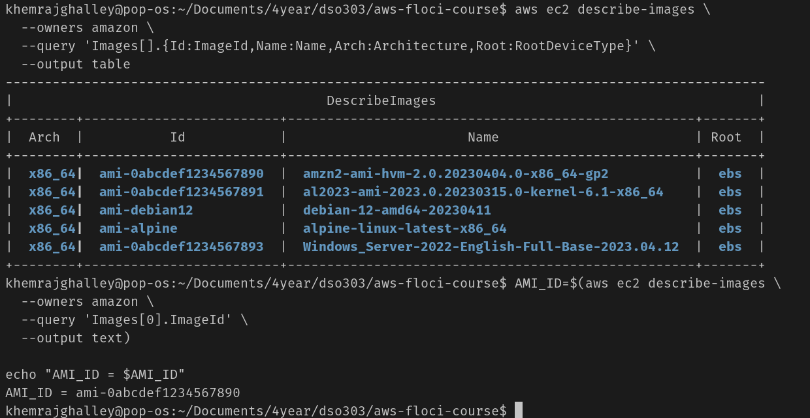
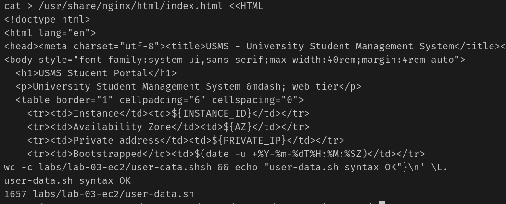
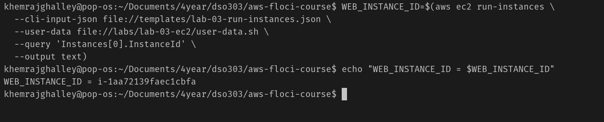
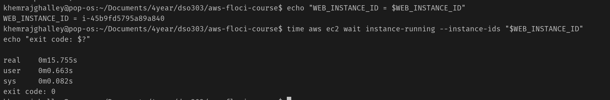
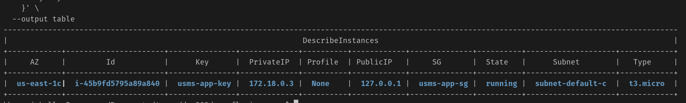
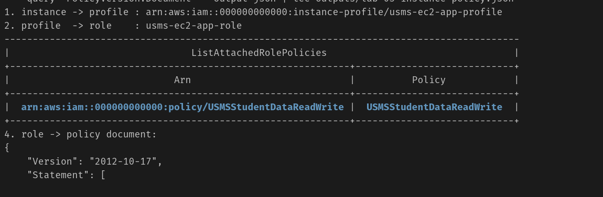

### Amazon EC2 and Deploying the USMS Application

**Aims**
- To lanuch USMS into the public subnet
- attach Security Group to the instance
- Give profile instance
 
what we are building
usms-web-01 in usms-public-subnet-a. servers the subnet on port 80, provide stable IP. and private subnet for database access. It has a security group that allows HTTP traffic from the internet and PostgreSQL traffic from the web tier's security group.

What is AMI?
Amazon Machine Image (AMI) is a pre-configured template for your EC2 instance that includes the operating system, application server, and applications. It allows user to launch instances quickly without having to configure the operating system and software from scratch.

  
his step shows how to find one programmatically, and what the right answer is on real AWS.

**Write the user-data bootstrap script**

cloud-init executes this script with root privileges during the initial boot process, ensuring that the portal is available without requiring user login.

**Launch the USMS web server**

**Wait for the instance to reach running**
the instance is now running successfully with exit status 0.

**Read the instance back and understand the fields**

**Trace the permission chain from the instance to the policy**

**Prove the user data actually arrived**

    

